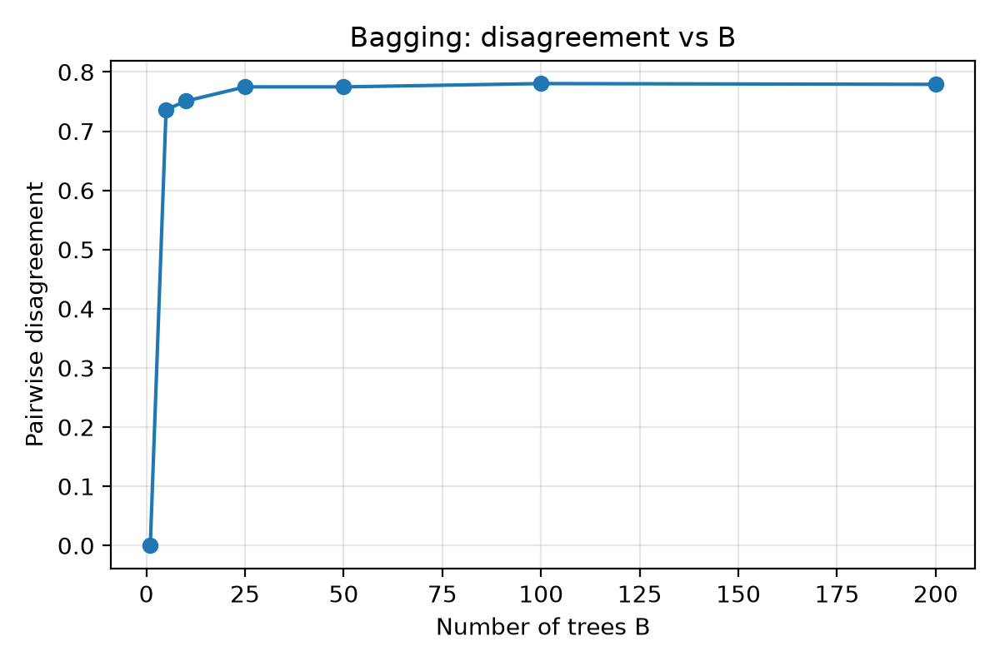
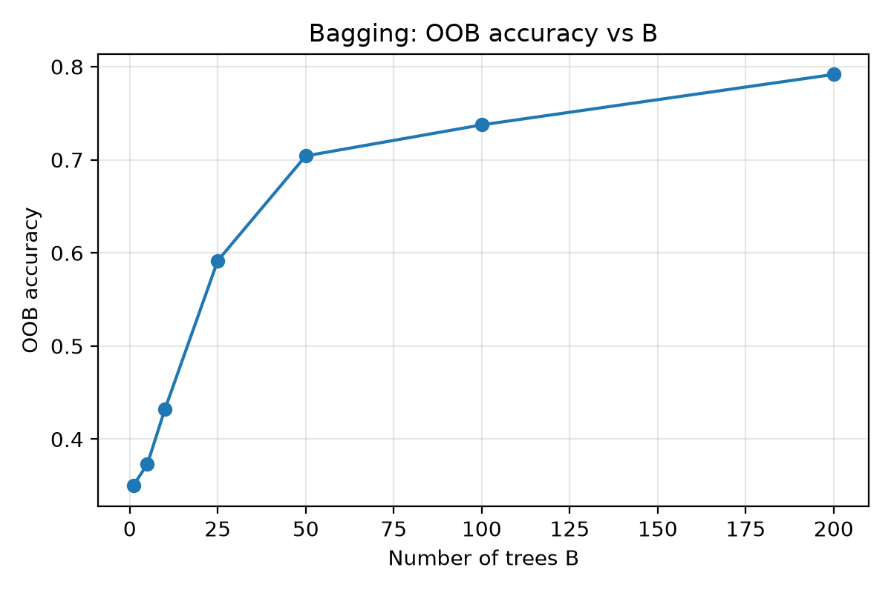
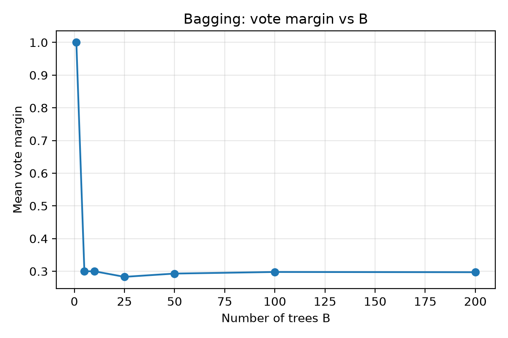
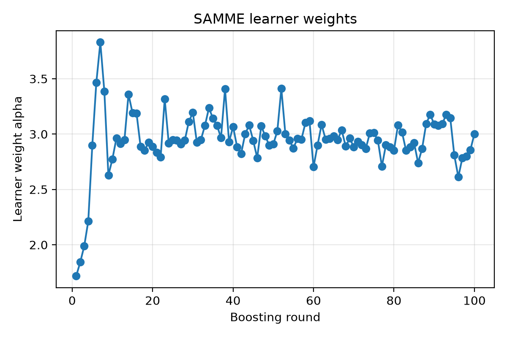
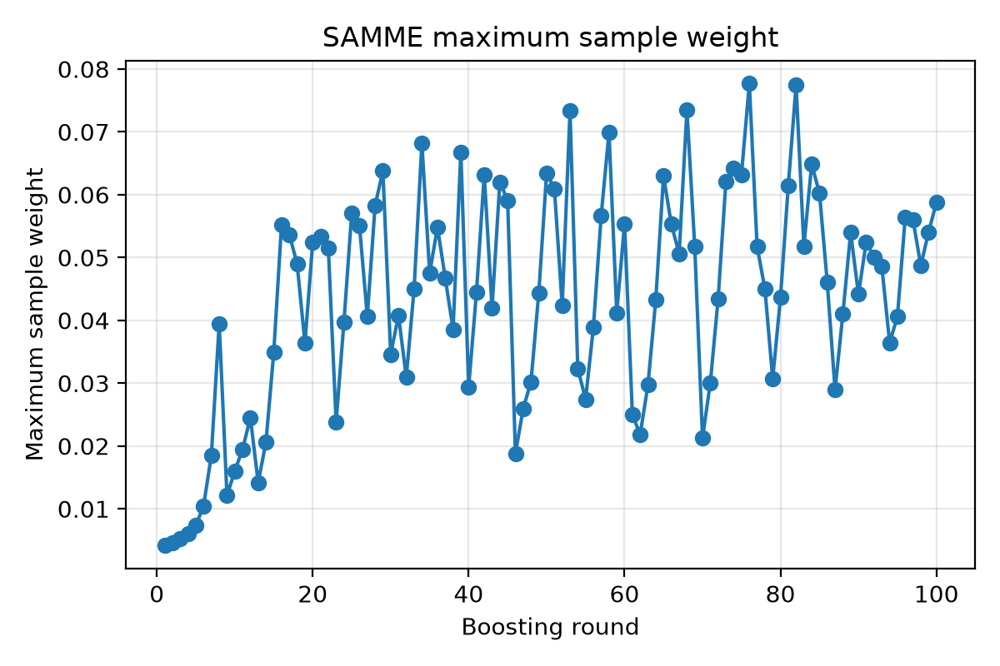
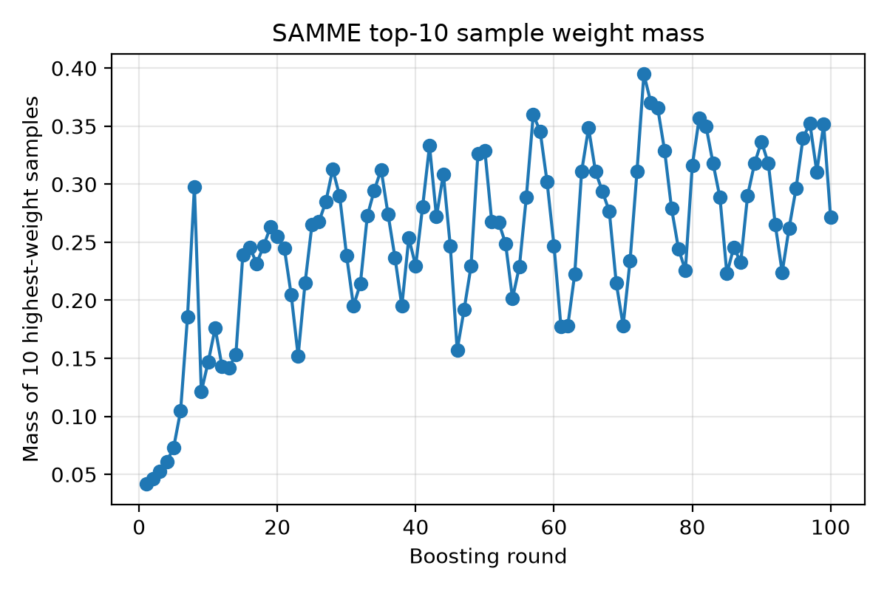
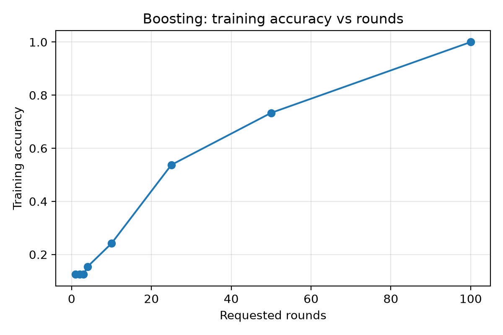
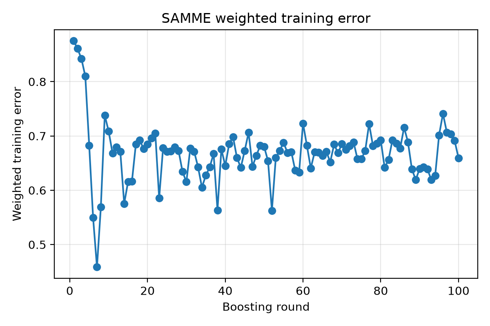
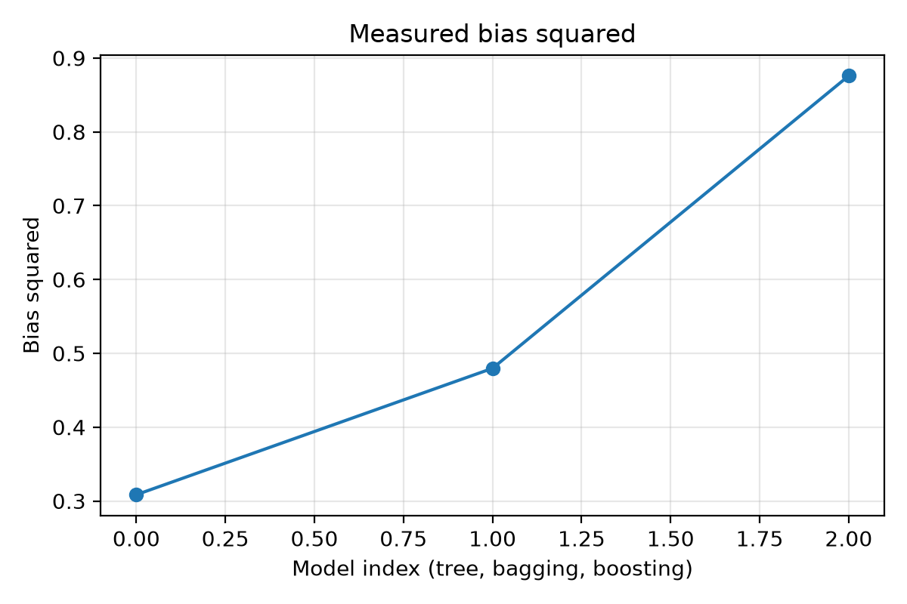
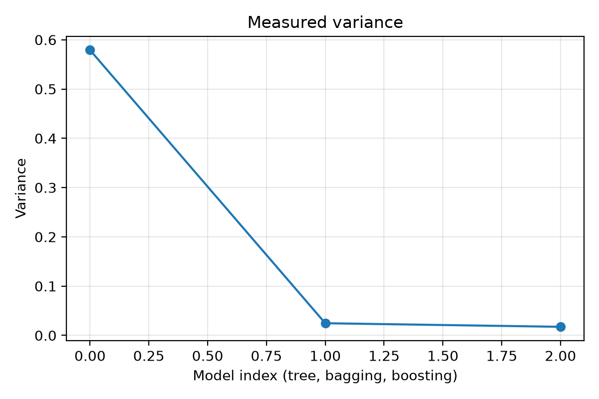

# Figures

Experiment plots generated by the **ML Assignment 2** scripts are stored in this folder.

> For the full analysis, see the [final report](../report.pdf). For setup and reproduction steps, see the [main README](../../README.md).

---

## Question 1: Bagging

| Figure | File |
|--------|------|
| Disagreement | [`q1_disagreement.png`](q1_disagreement.png) |
| OOB accuracy | [`q1_oob_accuracy.png`](q1_oob_accuracy.png) |
| Vote margin | [`q1_vote_margin.png`](q1_vote_margin.png) |

### Disagreement

### OOB Accuracy

### Vote Margin

---

## Question 2: SAMME Boosting

| Figure | File |
|--------|------|
| Learner weights | [`q2_learner_weights.png`](q2_learner_weights.png) |
| Max sample weight | [`q2_max_sample_weight.png`](q2_max_sample_weight.png) |
| Top-10 weight mass | [`q2_top10_weight_mass.png`](q2_top10_weight_mass.png) |
| Training accuracy | [`q2_training_accuracy.png`](q2_training_accuracy.png) |
| Weighted training error | [`q2_weighted_training_error.png`](q2_weighted_training_error.png) |

### Learner Weights

### Max Sample Weight

### Top-10 Weight Mass

### Training Accuracy

### Weighted Training Error

---

## Question 3: Bias–Variance

| Figure | File |
|--------|------|
| Bias squared | [`q3_bias_squared.png`](q3_bias_squared.png) |
| Variance | [`q3_variance.png`](q3_variance.png) |

### Bias Squared

### Variance

---

> **Note:** These plots are generated by `run_experiments.py`. Re-running the experiments with the fixed seed (`26511`) reproduces them.
